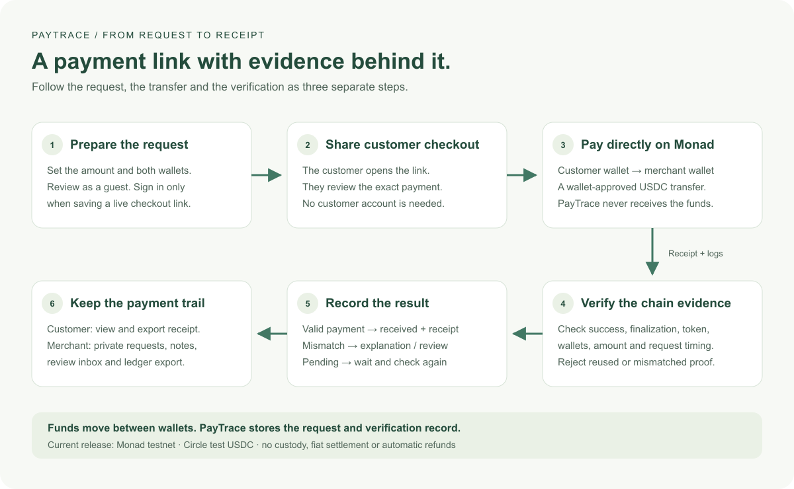
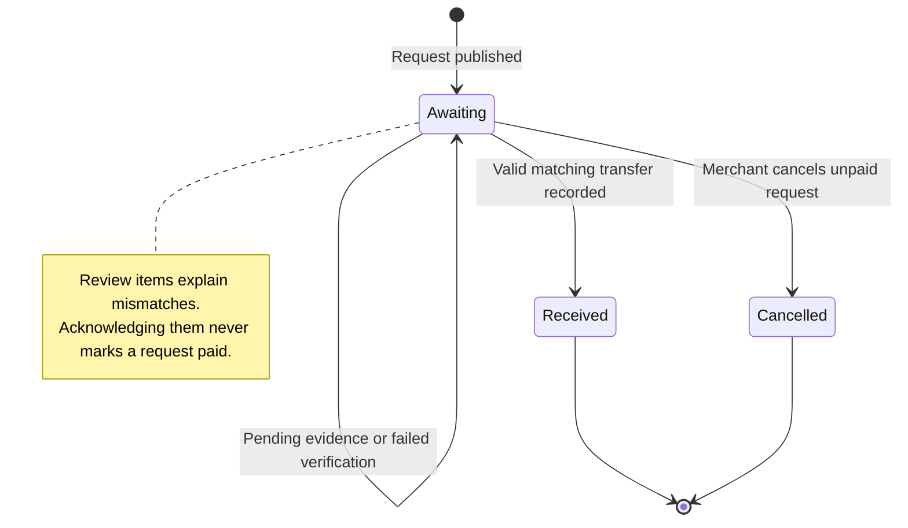
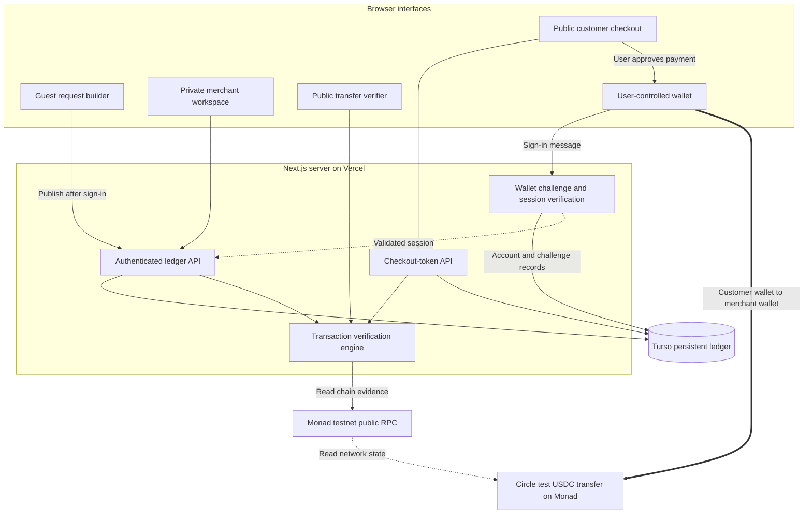

<div align="center">
  

# Send a payment link. Know when you’re paid.

**USDC payment requests, customer checkout and verified receipts for freelancers and businesses.**

[Open PayTrace](https://paytrace-tau.vercel.app) · [Watch the demo](https://www.youtube.com/watch?v=gTR4EguxiNI) · [Watch the pitch](https://www.youtube.com/watch?v=SPiFOYZD9ZA) · [Try the verifier](https://paytrace-tau.vercel.app/verify)

**Built on Monad testnet · Non-custodial · Guest-first onboarding**

</div>

> **Current scope:** PayTrace is a working testnet application using Circle test USDC. Test tokens have no monetary value. This release does not process mainnet payments or bank settlements.

## What is PayTrace?

PayTrace helps a business answer a simple question: **“Has this customer actually paid this request?”**

A merchant prepares a request, shares a checkout link, and receives USDC directly into their wallet. PayTrace checks the transaction against the request before marking it as received. Both sides can then access a receipt, while the merchant keeps the request, evidence and private notes together in a workspace.

You can prepare a request before signing in. Customers never need a PayTrace account to pay. The product combines a simple payment experience with explicit checks behind every “received” status.

## Start here

| What you want to do | Where to go |
| --- | --- |
| See the product in action | [Demo video on YouTube](https://www.youtube.com/watch?v=gTR4EguxiNI) |
| Hear the problem and product story | [Pitch video on YouTube](https://www.youtube.com/watch?v=SPiFOYZD9ZA) |
| Prepare a request without an account | [Start a payment request](https://paytrace-tau.vercel.app/start) |
| Open your merchant workspace | [Sign in with your wallet](https://paytrace-tau.vercel.app/login) |
| Inspect a transfer without signing in | [Public transaction verifier](https://paytrace-tau.vercel.app/verify) |
| Follow the user walkthrough | [Payment playbook](https://paytrace-tau.vercel.app/guide) |
| Explore implementation details | [Technical documentation](documentation/index.mdx) |

The video links open YouTube directly; they do not point to GitHub raw files.

## Contents

- [The problem](#why-we-built-it)
- [Users and use cases](#who-it-is-for-and-how-they-can-use-it)
- [Illustrated product workflow](#how-the-whole-flow-fits-together)
- [Payment verification and states](#what-verified-means)
- [Architecture and privacy](#architecture-and-data-boundaries)
- [Technology and Monad integration](#technology-and-monad-integration)
- [Try the complete flow](#try-the-complete-flow)
- [Run locally](#run-locally)
- [Hosting and configuration](#hosting-and-configuration)
- [Validation and evidence](#validation-and-evidence)
- [Code map](#code-map)
- [Limitations and next steps](#current-limitations-and-next-steps)

## Why we built it

A wallet can show that a transfer happened. That does not automatically tell a business which customer request it pays.

The merchant still needs to check the token, amount, receiving address and sender, confirm that the transaction succeeded, and avoid counting the same transfer twice. Screenshots and scattered transaction hashes leave that work to the person receiving the payment.

PayTrace connects the business context to the transaction evidence. A request states what should arrive; verification checks what actually arrived; the ledger keeps the result. A submitted hash is a starting point for verification, not proof that a bill has been paid.

## Who it is for and how they can use it

These are intended use cases, not claims of existing customers or adoption. The current release lets users test these workflows on Monad testnet.

| User | Example workflow | What PayTrace gives them |
| --- | --- | --- |
| Freelancer | Request payment for a design, development or writing milestone. Share the checkout with the client. | A payment record connected to the work, with a receipt after verification. |
| Small agency | Create separate requests for several clients and search by customer or description. | A clear view of outstanding and received payments, private notes and CSV exports. |
| Independent consultant | Agree on an exact amount and expected payer wallet before issuing a request. | A check that the submitted transfer came from the expected wallet and matches the amount. |
| Business accepting USDC | Share a payment link after agreeing on an order or service. | An account-free customer checkout and an organized merchant ledger. |
| Customer | Open a checkout, approve a transfer, or submit the hash of an already-sent payment. | Visible verification results and a downloadable or printable receipt. |
| Builder or testnet operator | Import a historical transfer or faucet funding receipt separately. | Funding evidence that cannot accidentally settle a new customer request in the same workspace. |

**A concrete example:** a designer creates a request for 25 test USDC for “Homepage design, milestone 1.” The client opens the link and pays from the expected wallet. PayTrace verifies the transfer and records the request as received. If the client submits a 20 test USDC transfer instead, the request stays unpaid and the mismatch is explained. PayTrace does not silently treat a partial payment as full payment.

## How the whole flow fits together



[Open the full-size diagram](docs/images/payment-flow.png) · [Scalable diagram source](docs/images/payment-flow.svg)

### 1. Prepare first, sign in when saving

The merchant enters a customer reference, description, exact amount, receiving wallet and expected payer wallet. The guest flow validates these details and presents a review screen before asking for authentication.

The prepared draft stays in the same browser tab’s session storage through sign-in. It is not yet a live payment request and cannot receive a checkout payment. After sign-in, the merchant returns to review and explicitly publishes it.

This lets people understand the product before committing to an account. Drafts are not cloud-synced and should not be treated as permanent records.

### 2. Prove wallet ownership and open a workspace

For new merchants, PayTrace uses Sign-In with Ethereum rather than a username and password. The server creates a short-lived challenge. The merchant approves its message in a compatible wallet, and the server verifies the signature before issuing a session.

The first successful sign-in creates a private workspace. Returning with the same wallet opens that workspace again. Signing in does not send tokens, consume gas or authorize token spending.

Existing password accounts remain accessible through [legacy sign-in](https://paytrace-tau.vercel.app/password-login). The original operator workspace remains at [owner access](https://paytrace-tau.vercel.app/owner). Wallet sign-in does not automatically merge those records into a new wallet account.

### 3. Publish an immutable payment request

When the merchant publishes, the server checks the RPC network and records the current block as the request’s starting point. It saves the request and an unguessable checkout token in persistent storage.

The amount, payer and receiving address are fixed for that request. Changing a workspace’s default receiving wallet later does not rewrite existing requests. The guest flow can also specify a receiving wallet for that particular request without changing the workspace default.

### 4. Let the customer pay directly

The customer opens the checkout link without creating an account. Checkout displays the amount, description and expected wallet addresses.

With a compatible injected wallet, the app checks the payer account, requests Monad testnet when needed, estimates gas and prepares an ERC-20 transfer. The customer approves the transaction in their wallet. **USDC goes directly from the customer’s wallet to the merchant’s wallet.** There is no PayTrace custody address or custom payment contract in between, and no token allowance is required.

If a payment has already been sent, the customer can submit its transaction hash instead. A saved hash is shown for verification before another payment is encouraged.

### 5. Verify evidence before changing the ledger

The server retrieves the receipt and block evidence from Monad RPC. It checks the supported token’s transfer event, then applies the request-specific rules. The browser cannot provide a trusted proof or set a request to “received.”

When all checks pass, the ledger claims that transfer event and updates the request within a database transaction. This prevents concurrent submissions from counting the same evidence twice inside the workspace.

If evidence is pending, unavailable or inconsistent, PayTrace does not mark the request paid. Request-matching failures can appear in the review inbox with a reason. Acknowledging a review item does not override verification.

### 6. Keep an understandable record

The customer sees the result and can download a JSON receipt or print the receipt page. The merchant can inspect the payment evidence, add private notes, cancel unpaid requests and export the request ledger as CSV.

Checkout retries pending verification for a bounded period of approximately four minutes while open. Its submitted hash is retained in that browser where storage is available. Merchant records refresh every 15 seconds. This is an interactive verification flow, not an unattended blockchain indexer.

### Detailed payment sequence

```mermaid
sequenceDiagram
    autonumber
    actor Merchant
    participant App as PayTrace interface
    actor Customer
    participant Wallet as Customer wallet
    participant Chain as Monad testnet
    participant API as PayTrace server
    participant DB as Workspace ledger

    Merchant->>App: Prepare and review a request as a guest
    Merchant->>API: Sign in with a verified wallet message
    Merchant->>API: Publish request
    API->>Chain: Check network and read starting block
    API->>DB: Save request, ownership and checkout token
    API-->>Merchant: Shareable checkout link
    Merchant-->>Customer: Share the link
    Customer->>App: Open checkout without an account
    Customer->>Wallet: Review and approve exact USDC transfer
    Wallet->>Chain: Send USDC directly to merchant wallet
    Wallet-->>App: Transaction hash
    App->>API: Submit hash for this checkout
    API->>Chain: Read receipt, canonical block and finalized block
    Chain-->>API: Transaction and transfer-event evidence
    API->>API: Validate token, amount, wallets, timing and evidence
    alt Valid payment and unused event
        API->>DB: Atomically claim event and mark request received
        API-->>App: Verified result and receipt evidence
        App-->>Customer: Show receipt
        DB-->>Merchant: Updated workspace on refresh
    else Pending or not finalized
        API-->>App: Keep awaiting; retry verification
    else Mismatch or invalid evidence
        API-->>App: Explain failure; do not mark paid
    end
```

The wallet signs and submits the transfer. PayTrace verifies and records it. These are separate responsibilities: the application does not control the customer’s keys or decide to move funds on their behalf.

## What “verified” means

Verification has two layers: a chain-level transfer check and a request-level match.

| Check | Why it matters |
| --- | --- |
| Network is Monad testnet, chain ID `10143` | Evidence from another network must not settle a request. |
| Receipt reports successful execution | A reverted transaction is not a payment. |
| Receipt matches the canonical block | Inconsistent or changed block evidence is rejected. |
| Receipt block is within the RPC provider’s finalized range | Inclusion alone is not treated as finalization. |
| Transfer comes from the allowlisted test USDC contract | A different token with the same name cannot count. |
| Recipient and exact integer amount match | A transfer to the wrong wallet, underpayment or overpayment cannot settle the request. |
| Sender matches the expected payer | An unrelated incoming transfer cannot be assigned automatically. |
| Transfer block follows the request’s starting block | An old transfer cannot pay a newly issued request. |
| Transfer is not a mint | Faucet funding is distinct from customer payment. |
| One unambiguous candidate transfer is present | Multiple incoming events are not silently added together. |
| Event has not already been claimed in this workspace | One event cannot settle two requests or count as both funding and payment. |

Amounts use six-decimal integer arithmetic rather than floating-point calculations. Evidence identity includes the chain ID, transaction hash and log index.

The public verifier checks a transfer against a recipient and expected amount. Settling a saved request adds the payer, timing and duplicate-claim rules. A public verifier result alone does not change the merchant ledger.

### Request states and exceptions



“Confirming” is a temporary checkout display while evidence is checked, not a separate saved financial status. Cancellation closes the checkout; it does not reverse funds or prevent an independent transfer to the wallet. Refunds must be handled separately outside this release.

## Architecture and data boundaries



### What is onchain?

The USDC transfer and its transaction receipt and event logs exist on Monad. PayTrace does not deploy a custom settlement contract. It uses the existing test USDC contract and verifies its evidence.

### What is stored by PayTrace?

The database stores account and workspace records, requests, checkout tokens, notes, review items, funding receipts and verified transaction evidence. The database is a record of the payment workflow; it is not a wallet.

Private ledger operations derive the workspace from the authenticated session. A client-supplied workspace ID cannot grant access to another merchant’s records. Public checkout tokens resolve to their owning workspace on the server and expose customer-facing fields rather than the private ledger.

### What is public and what stays private?

Anyone with a checkout link can view its description, amount, addresses and receipt evidence. Customer references and internal notes are excluded from that public response. Checkout links should therefore be shared intentionally, even though they do not require an account.

The server verifies wallet signatures using a five-minute, single-use challenge bound to the application origin and browser cookie. Sessions use signed, expiring HttpOnly cookies. Login attempt budgets persist in the database; some verification limits remain per process. These controls are implemented and tested, but the project has not undergone an independent security audit.

## Technology and Monad integration

| Component | Role in PayTrace |
| --- | --- |
| Next.js App Router, React and TypeScript | Responsive interface and server-side route handlers. |
| Monad testnet | Network used for transfers and transaction verification. |
| Circle test USDC | Allowlisted ERC-20 token used for request payments. |
| EIP-1193 wallet interface | Connects checkout and sign-in to a compatible browser wallet. |
| SIWE and ethers | Standard wallet sign-in messages and server-side signature verification. |
| Turso / `@libsql/client` | Persistent hosted storage; local SQLite for development. |
| Vercel | Hosts the application and server endpoints. |
| Node test runner and tsx | Automated tests for payments, authentication and ledger behavior. |

Network configuration is defined in [`src/lib/chain-types.ts`](src/lib/chain-types.ts):

| Setting | Value |
| --- | --- |
| Chain | Monad Testnet |
| Chain ID | `10143` |
| RPC | `https://testnet-rpc.monad.xyz` |
| Explorer | `https://testnet.monadscan.com` |
| Test USDC contract | `0x534b2f3A21130d7a60830c2Df862319e593943A3` |
| Token precision | 6 decimals |

The integration uses Monad’s public RPC directly. Circle integration here means use of its test USDC contract—not Circle Wallets, CCTP or Bridge Kit. No third-party indexing or embedded-wallet sponsor integration is implied.

## Try the complete flow

1. Open [Prepare a request](https://paytrace-tau.vercel.app/start).
2. Enter a reference, description, amount and two different wallet addresses: a merchant recipient and an expected payer.
3. Review the draft, then sign in with a compatible wallet when saving. Return to review and publish.
4. Open the resulting checkout link in the payer’s wallet-enabled browser. The payer needs test USDC and test MON for gas.
5. Check the receiving address and amount, then approve the transfer. Wait for verification, or submit the existing transaction hash if you paid manually.
6. Inspect the receipt and return to the merchant workspace to see the saved result.

Use the payer address recorded on the request. Send only after publishing the request. To test a mismatch, submit a nonmatching transfer and check the explanation; do not expect it to be marked received. Historical transfers belong in funding receipts.

**Wallet compatibility:** standard externally owned Ethereum-compatible wallets with an injected provider are supported. On mobile, use the wallet’s own browser. WalletConnect and smart-contract-wallet sign-in are not implemented. A regular browser without a wallet can still prepare drafts, inspect public evidence and view checkout details.

## Run locally

### Requirements

- Node.js **24 or later**, matching the repository’s declared engine; Node 24 is used in CI.
- npm and Git.
- Network access to Monad RPC for real verification and request publication.
- A compatible wallet only when testing wallet interactions.

```sh
git clone https://github.com/Nailer/paytrace.git
cd paytrace
npm ci
npm run dev
```

Open **http://127.0.0.1:3100**. To work directly with the local ledger, open **http://127.0.0.1:3100/workspace**.

Without hosted configuration, local development uses a loopback-only operator workspace and `.data/paytrace.sqlite`. It does not reproduce hosted account isolation: the local operator API deliberately opens that development workspace without requiring sign-in. Do not expose this mode on a public interface.

To test the deployed guest-to-wallet-authentication experience, use the live application or configure a separate HTTPS environment using the hosting guide. Wallet authentication endpoints require a session secret; merely launching the local server is not equivalent to setting up a hosted multi-account environment.

For a local production build:

```sh
npm run build
npm start
```

Both development and production start scripts bind to `127.0.0.1:3100`. Local records are not automatically uploaded to the hosted app. The `/demo` route is an archived, labelled design prototype; `/start`, `/workspace` and real checkout links are the working product flow.

## Hosting and configuration

See the complete [deployment and backup guide](docs/DEPLOYMENT.md) before deploying your own instance.

| Variable | Purpose |
| --- | --- |
| `PAYTRACE_PUBLIC_ORIGIN` | Exact public HTTPS origin, without a trailing slash. |
| `PAYTRACE_SESSION_SECRET` | Server-only secret used to sign sessions and related authentication data. |
| `PAYTRACE_PASSWORD_HASH` | Retained original-owner authentication configuration required by hosted mode. |
| `PAYTRACE_PROD_TURSO_DATABASE_URL` | Dedicated production Turso database URL; preferred over the generic URL. |
| `PAYTRACE_PROD_TURSO_AUTH_TOKEN` | Server-only production database credential. |
| `TURSO_DATABASE_URL`, `TURSO_AUTH_TOKEN` | Generic remote database configuration for appropriately separated environments. |
| `PAYTRACE_DB_PATH` | Local SQLite path on a persistent Node host; not a substitute for remote storage on Vercel. |

Generate initial hosting credentials in a fresh checkout with:

```sh
node scripts/setup-hosting.mjs https://your-app.example.com
```

The script creates private `.env.hosting` and `.env.hosting-password` files and refuses to overwrite existing credentials. Add the configuration to your host’s private environment settings. Never commit these files, record them in a demo, or expose secrets with a `NEXT_PUBLIC_` prefix.

Vercel requires remote Turso storage because its local filesystem is not a persistent ledger. Keep preview and development databases separate from production. For a persistent Node host, the repository also includes a Dockerfile and a backup script. Backups contain private records and checkout tokens and must be handled as private data.

## Validation and evidence

```sh
npm test
npm run typecheck
npm run build
```

The current suite contains **46 passing tests**, including:

- Exact token arithmetic and wallet transfer encoding.
- Wrong-network, wrong-token, wrong-recipient and amount-mismatch rejection.
- Reverted, unfinalized and inconsistent chain evidence.
- Expected payer, request timing and mint-versus-payment checks.
- Duplicate evidence claims, concurrent authentication replay and rollback behavior.
- Workspace isolation, session integrity and recovery for legacy accounts.
- Wallet signature ownership, origin/browser binding, expiry and returning-account identity.
- Guest draft validation, cancellation, review handling, CSV safety and persistence.

[GitHub Actions](https://github.com/Nailer/paytrace/actions) runs installation, tests, production build and type checking. Automated chain fixtures test decision logic; they are not live transaction evidence.

During development, a fresh 1 test USDC payment was verified against Monad testnet and matched to a request. Hosted acceptance checks separately exercised wallet sign-in, persistent storage, request publication, public checkout access, replay rejection, workspace isolation and cancellation. The [demo video](https://www.youtube.com/watch?v=gTR4EguxiNI) is provided for the product walkthrough. Passing tests and a working deployment are not a security audit or a claim of mainnet readiness.

## Code map

| Location | What to inspect |
| --- | --- |
| [`src/components/request-starter.tsx`](src/components/request-starter.tsx) | Guest preparation, review and draft continuation. |
| [`src/components/wallet-login.tsx`](src/components/wallet-login.tsx) | Wallet sign-in experience. |
| [`src/lib/wallet-auth.ts`](src/lib/wallet-auth.ts) | Sign-in challenge creation and signature verification. |
| [`src/components/checkout.tsx`](src/components/checkout.tsx) | Customer checkout, pending verification and receipts. |
| [`src/lib/wallet-payment.ts`](src/lib/wallet-payment.ts) | Wallet checks and direct USDC transfer preparation. |
| [`src/lib/chain-verification.ts`](src/lib/chain-verification.ts) | Receipt, block and token-event verification. |
| [`src/lib/ledger.ts`](src/lib/ledger.ts) | Persistent records, workspace scoping and evidence claims. |
| [`src/app/api`](src/app/api) | Server endpoints for accounts, requests, tracking and verification. |
| [`tests`](tests) | Automated behavioral coverage. |
| [`documentation`](documentation) | Extended architecture, API, operations and user documentation. |

## Current limitations and next steps

The release is intentionally specific: Monad testnet, test USDC, one workspace per account and exact-amount payment requests. It does not include mainnet payments, fiat conversion, bank payouts, automatic refunds, team roles, email login, account linking or background chain indexing.

Verification relies on the RPC provider’s evidence and finalized-block view; PayTrace is not an independent consensus client. Public RPC availability and rate limits can delay verification. A closed browser does not keep the checkout’s verification loop running.

Wallet access requires retaining control of the sign-in wallet. PayTrace cannot recover its keys. Legacy account recovery codes apply to those password accounts, not to wallet recovery.

Next priorities are to test the workflow with freelancers and small businesses, improve mobile wallet coverage, explore payment notifications and accounting integrations, and strengthen monitoring and abuse protection. Supporting real funds on mainnet requires further operational work and an independent security review. These are planned improvements, not features claimed in this submission.

## Further reading

- [User guide](https://paytrace-tau.vercel.app/guide)
- [Technical documentation entry point](documentation/index.mdx)
- [Architecture overview](documentation/architecture/overview.mdx)
- [API reference](documentation/api-reference/introduction.mdx)
- [Hosting and backups](docs/DEPLOYMENT.md)
- [Release history and checklist](docs/RELEASE.md)
- [Security limitations](documentation/security/limitations.mdx)

**PayTrace keeps the request, the payment evidence and the receipt together—so getting paid is easier to follow.**
