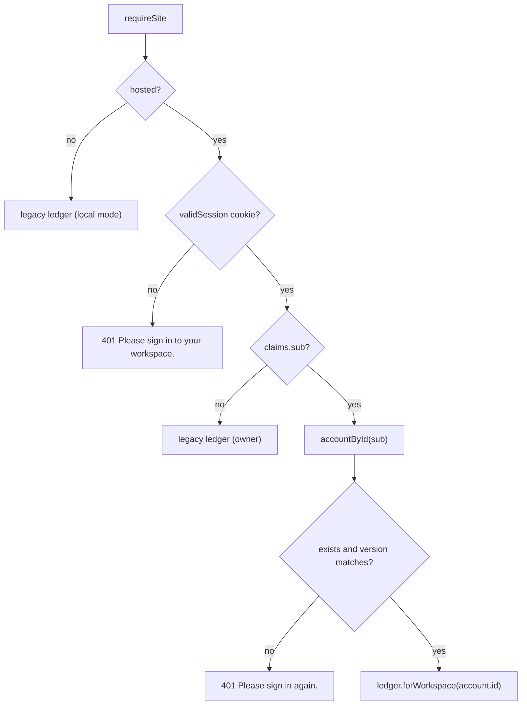
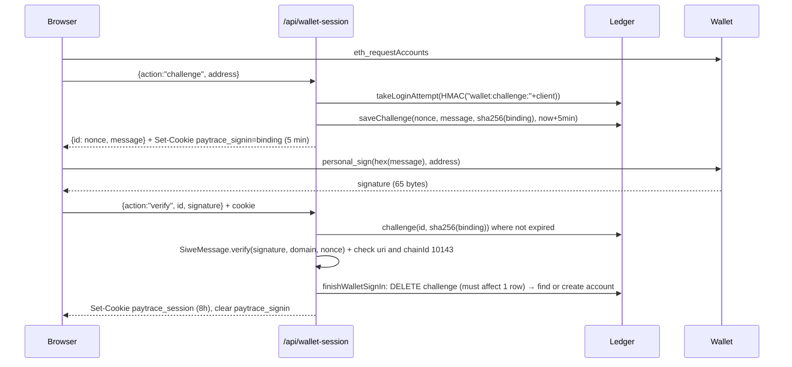

## Session token

Sessions are **stateless HMAC-SHA256 signed tokens** (a compact JWS-like format), stored in an `HttpOnly` cookie named `paytrace_session`.

```text
<base64url(JSON payload)>.<base64url(HMAC-SHA256(secret, payloadB64))>
```

```json payload
{ "sub": "<account uuid | undefined for owner>", "version": 1, "exp": 1791900000000, "nonce": "<16 random bytes hex>" }
```

| Property | Value |
| --- | --- |
| Signing key | `PAYTRACE_SESSION_SECRET` (≥ 32 chars) |
| Lifetime | 8 hours (`exp` must be > now and ≤ now + 8 h) |
| Max token length | 1000 chars |
| Comparison | `timingSafeEqual` on raw HMAC bytes |
| Cookie | `Path=/; HttpOnly; SameSite=Strict; Max-Age=28800`, plus `Secure` when hosted |
| Revocation | Account `version` bump (recovery), or rotating the secret (global) |

<Accordion title="In plain English" icon="lightbulb">
When you log in, PayTrace gives your browser a "wristband": a small note saying who you are and when it expires, stamped with a secret seal only the server can make. JavaScript on the page can't read it (`HttpOnly`), other websites can't make your browser send it (`SameSite=Strict`), and it only travels over HTTPS (`Secure`). After 8 hours it stops working.
</Accordion>

## Request authorization: `operatorLedger(request)`



## Origin and host enforcement: `requireSite(request)`

**Hosted mode** (`PAYTRACE_PUBLIC_ORIGIN` set):
1. `Host` must equal the public origin's host → else 403 *"Unrecognized application host."*
2. If an `Origin` header is present it must equal the public origin; for any non-GET/HEAD method it is **required** → else 403 *"Open this action from PayTrace."*
3. `Sec-Fetch-Site: cross-site` on non-GET → 403 *"Cross-site action blocked."*

**Local mode**: `Host` must be `127.0.0.1`, `localhost` or `[::1]` (any port); `Origin`, if present, must be `http(s)://<host>`; any `cross-site` fetch is rejected.

Configuration validation (`publicOrigin()`) returns 503 if the origin isn't `https:` without trailing slash, or the secret/password hash are missing. On Vercel, a missing origin is itself a 503.

<Accordion title="In plain English" icon="lightbulb">
These checks make sure that any action that changes data comes from PayTrace's own pages, not from a malicious website trying to trick your browser into acting on your behalf (an attack called CSRF).
</Accordion>

## Wallet sign-in (EIP-4361)



| Field | Value |
| --- | --- |
| `domain` | Host of public origin (or request origin locally) |
| `address` | EIP-55 checksummed |
| `statement` | "Sign in to your PayTrace workspace. This does not authorize a payment or token access." |
| `uri` | Public origin |
| `version` | `1` |
| `chainId` | `10143` |
| `nonce` | 24 random bytes hex (48 chars); also the challenge ID |
| `issuedAt` / `expirationTime` | now / now + 5 min |

**Security properties** (tested in `tests/wallet-auth.test.ts`):
- **Ownership:** signature must recover to the message address.
- **Browser binding:** the challenge is bound to a random 32-byte value held only in an HttpOnly cookie; the DB stores its SHA-256. A stolen nonce is useless from another browser.
- **Origin binding:** domain and URI must match the deployment.
- **Single use:** `DELETE … WHERE id AND binding AND expires>now` must affect exactly one row inside the sign-in transaction; concurrent replays lose.
- **Expiry:** 5 minutes; expired rows are purged on each new challenge.

<Accordion title="In plain English" icon="lightbulb">
The login message is unique, expires in 5 minutes, works only once, only on this website, and only in the browser that asked for it. Even if someone copied your signed message, they couldn't use it.
</Accordion>

## Password sign-in: `/api/session`

Actions: `signin` (default), `signup`, `recover`, `owner`. See [Password accounts](/guides/password-accounts) for hashing details. `owner` verifies against `PAYTRACE_PASSWORD_HASH` and issues a session with no `sub`.

## Login rate limiting

```ts
const client = process.env.VERCEL ? firstIp(x-forwarded-for) || 'unknown' : 'single-host';
const key = HMAC_SHA256(secret, `account:${action}:${client}`); // or `wallet:${action}:${client}`
await ledger().takeLoginAttempt(key); // ≤ 5 per 15 min, else 429
```

- Stored in `login_limits`, so it persists across restarts and serverless instances.
- IPs are never stored in plaintext (HMAC).
- On non-Vercel hosts, all clients share one `single-host` bucket per action. Put edge rate limiting in front for public exposure.
- Every attempt counts, successful or not.

## Sign-out

`DELETE /api/session` clears the session cookie (`Max-Age=0`). Because tokens are stateless, a copied token remains valid until `exp` unless the secret rotates or the account version changes.
