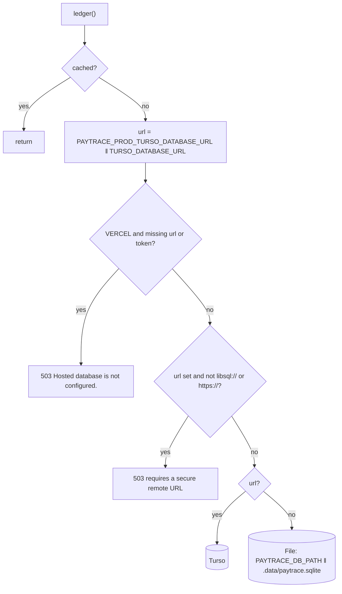
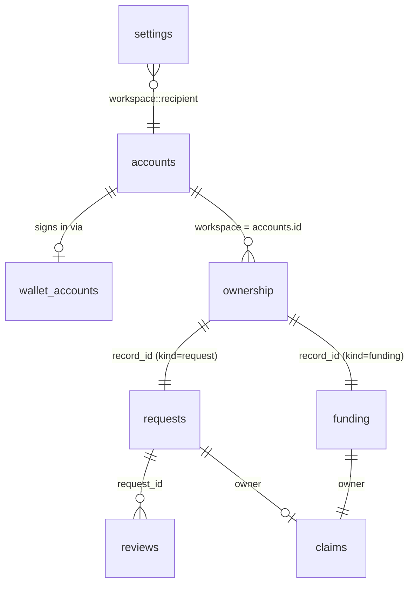

## Backend selection: `ledger()`

`ledger()` returns a **process-wide singleton** cached on `globalThis.paytraceLedger` (survives Next.js dev hot reloads).



On first use it logs `PayTrace storage { backend, database: sha256(url)[0..12], hosted }`. The URL itself is never logged.

<Accordion title="In plain English" icon="lightbulb">
When PayTrace starts, it decides where to save data: a cloud database (Turso) if one is configured, otherwise a local file. On Vercel it **refuses** to run without the cloud database, because Vercel wipes local files, and losing payment records silently would be worse than not starting.
</Accordion>

## Schema

All tables are created idempotently in one `write` batch at construction.

```sql
CREATE TABLE IF NOT EXISTS settings (key TEXT PRIMARY KEY, value TEXT NOT NULL);
CREATE TABLE IF NOT EXISTS requests (id TEXT PRIMARY KEY, token TEXT UNIQUE NOT NULL, data TEXT NOT NULL);
CREATE TABLE IF NOT EXISTS funding  (id TEXT PRIMARY KEY, data TEXT NOT NULL);
CREATE TABLE IF NOT EXISTS reviews  (id TEXT PRIMARY KEY, request_id TEXT NOT NULL, hash TEXT NOT NULL,
                                     reason TEXT NOT NULL, at TEXT NOT NULL, resolved INTEGER NOT NULL DEFAULT 0,
                                     UNIQUE(request_id, hash));
CREATE TABLE IF NOT EXISTS claims    (evidence_id TEXT PRIMARY KEY, owner TEXT NOT NULL);
CREATE TABLE IF NOT EXISTS ownership (record_id TEXT PRIMARY KEY, kind TEXT NOT NULL, workspace TEXT NOT NULL);
CREATE INDEX IF NOT EXISTS ownership_workspace ON ownership(workspace, kind);
CREATE TABLE IF NOT EXISTS accounts  (id TEXT PRIMARY KEY, username TEXT UNIQUE NOT NULL, name TEXT NOT NULL,
                                      password TEXT NOT NULL, recovery TEXT NOT NULL, version INTEGER NOT NULL DEFAULT 1);
CREATE TABLE IF NOT EXISTS auth_challenges (id TEXT PRIMARY KEY, message TEXT NOT NULL, binding TEXT NOT NULL, expires INTEGER NOT NULL);
CREATE TABLE IF NOT EXISTS wallet_accounts (wallet TEXT PRIMARY KEY, account_id TEXT NOT NULL UNIQUE);
CREATE TABLE IF NOT EXISTS login_limits    (key TEXT PRIMARY KEY, attempts INTEGER NOT NULL, expires INTEGER NOT NULL);
```

### Entity relationships



### Table reference

| Table | Purpose | Key constraints |
| --- | --- | --- |
| `settings` | Receiving wallet per workspace | PK `key` |
| `requests` | Request JSON (`RequestRecord`) | PK `id`, **UNIQUE `token`** |
| `funding` | Funding JSON (`FundingRecord`) | PK `id` |
| `reviews` | Failed-match explanations | **UNIQUE(`request_id`,`hash`)** |
| `claims` | Used evidence IDs | **PK `evidence_id`** |
| `ownership` | Record → workspace mapping | PK `record_id`, index `(workspace, kind)` |
| `accounts` | Password and wallet accounts | **UNIQUE `username`**, `version` for revocation |
| `auth_challenges` | SIWE nonces | PK `id` (nonce); `binding` = SHA-256 of cookie value; `expires` ms |
| `wallet_accounts` | Wallet → account | PK `wallet`, **UNIQUE `account_id`** |
| `login_limits` | Sign-in rate-limit buckets | PK `key` (HMAC), `attempts`, `expires` |

## Transactions

`atomic(fn)` wraps `db.transaction('write')`. Every multi-step mutation uses it: `create`, `importFunding`, `match`, `cancel`, `review`, `note`, `saveChallenge`, `finishWalletSignIn`, `takeLoginAttempt`. Rollback on throw is guaranteed and tested (*"a failed write rolls back its evidence claim"*).

<Accordion title="In plain English" icon="lightbulb">
Every change that involves several steps is done as one "all-or-nothing" package. If step 3 of 4 fails, steps 1 and 2 are undone automatically. You never get half-saved payments.
</Accordion>

## Legacy compatibility

Records created before multi-account support have no `ownership` row. The scope predicate treats them as belonging to `legacy`:

```sql
(id IN (SELECT record_id FROM ownership WHERE kind='request' AND workspace=:ws)
 OR (:ws = 'legacy' AND id NOT IN (SELECT record_id FROM ownership WHERE kind='request')))
```

The workspace value interpolated here is validated to be `legacy` or a 36-char UUID (`^[a-f0-9-]{36}$`) before use.

## Persistence guarantees

- Local: SQLite in WAL mode files (`paytrace.sqlite`, `-wal`, `-shm`) under a `0700` directory.
- Survives process restarts (test: *"database survives closing and reopening"*).
- Vercel: verified that wallet settings, both request records, the historical receipt and an exact checkout token survived a complete redeployment.
