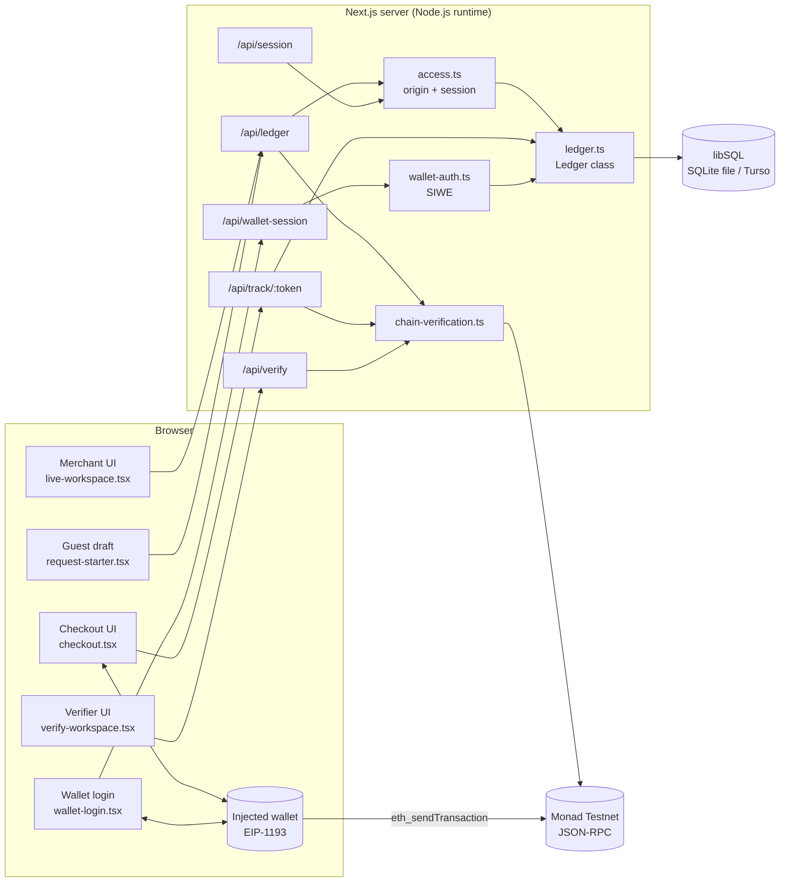
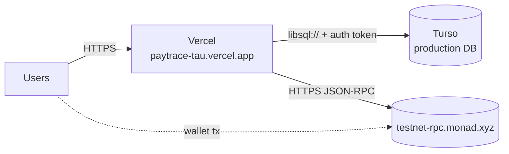

PayTrace is a **monolithic Next.js App Router application**. React Server Components and Client Components render the UI; **Route Handlers** under `src/app/api/**/route.ts` expose a small JSON API running on the **Node.js runtime**. A single `Ledger` class encapsulates persistence via `@libsql/client`, targeting either an embedded SQLite file or a remote Turso (libSQL) database. Chain access is an internal minimal JSON-RPC client over `fetch`. There are no background workers, queues or smart contracts.

<Accordion title="In plain English" icon="lightbulb">
PayTrace is one web application. The same codebase serves the web pages and a small set of server "endpoints" that do the real work. It stores data in one database, and talks to the Monad blockchain through simple web requests. There's no extra moving machinery.
</Accordion>

## Component diagram

## Trust boundaries

| Boundary | Trusted side | Untrusted side | Enforcement |
| --- | --- | --- | --- |
| Browser ↔ server | Server | Everything from the browser | Input validation, 4–8 KiB body limits, origin/host checks, signed sessions |
| Server ↔ RPC | — (trusted for chain facts) | — | Chain ID check, structural validation of every field, fail-closed |
| Merchant ↔ merchant | Each workspace | Other workspaces | Session-derived workspace, ownership table, scoped claims |
| Payer ↔ merchant data | Merchant private fields | Payer via token | `tracking()` projection omits customer and notes |
| Wallet ↔ PayTrace | Wallet (holds keys) | PayTrace | PayTrace never sees keys; user approves every signature |

## Runtime modes

| Mode | Trigger | Auth on `/api/ledger` | Storage |
| --- | --- | --- | --- |
| **Local** | `PAYTRACE_PUBLIC_ORIGIN` unset (and not on Vercel) | None; loopback-only host check | `.data/paytrace.sqlite` or `PAYTRACE_DB_PATH` |
| **Hosted (single host / Docker)** | `PAYTRACE_PUBLIC_ORIGIN` set | Signed session cookie + exact origin | `PAYTRACE_DB_PATH` (e.g. `/data/paytrace.sqlite`) |
| **Hosted (Vercel)** | `VERCEL` + `PAYTRACE_PUBLIC_ORIGIN` | Signed session cookie + exact origin | Turso, required; fails closed with 503 if missing |

## Deployment topology (production)

## Design decisions

<AccordionGroup>
  <Accordion title="Why no smart contract?">
    A plain ERC-20 `transfer` already emits an indexed, verifiable event. A payment-router contract would add audit surface, deployment cost and an approval step without improving verification. **Plain English:** USDC already writes a clear public note when it moves; there's no need for an extra program.
  </Accordion>
  <Accordion title="Why on-demand verification instead of an indexer?">
    Indexing requires a continuously running worker, durable checkpoints and log-range pagination (Monad's public RPC caps `eth_getLogs` to 100 blocks). On-demand verification by known hash is simpler and sufficient for an MVP. Trade-off: if the payer closes checkout and nobody submits the hash, the request isn't updated automatically. **Plain English:** PayTrace checks when someone asks, rather than watching the blockchain 24/7.
  </Accordion>
  <Accordion title="Why store requests as JSON blobs?">
    Records are small, read whole, and mutated inside write transactions. JSON columns keep the schema stable across iterations; uniqueness-critical data (`token`, `claims.evidence_id`, `reviews(request_id,hash)`, `wallet_accounts`) lives in proper constrained columns.
  </Accordion>
  <Accordion title="Why libSQL?">
    One client API (`@libsql/client`) supports an embedded file for local/Docker and Turso over `libsql://` for serverless Vercel, whose filesystem is ephemeral.
  </Accordion>
</AccordionGroup>
