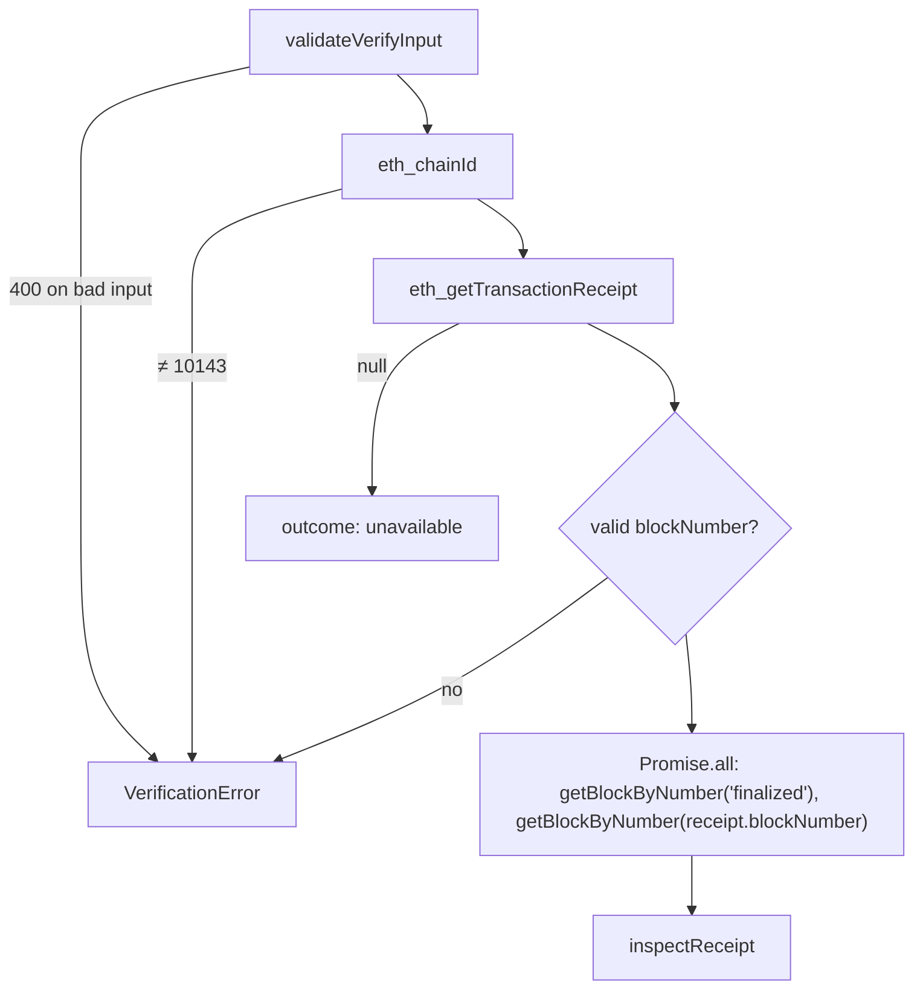

The verification engine is a **pure function over RPC responses**. `verifyTransfer(input, rpc)` performs I/O; `inspectReceipt(input, receipt, finalized, canonical, now)` is deterministic and side-effect free, which makes it directly testable with fixtures.

<Accordion title="In plain English" icon="lightbulb">
The checker is split in two: one part fetches data from the blockchain, the other part makes the decision. The decision part always gives the same answer for the same data, which makes it easy to test thoroughly with fake examples.
</Accordion>

## Constants

```ts src/lib/chain-types.ts
export const MONAD_TESTNET = {
  chainId: 10143,
  name: 'Monad Testnet',
  rpc: 'https://testnet-rpc.monad.xyz',
  explorer: 'https://testnet.monadscan.com',
  usdc: '0x534b2f3A21130d7a60830c2Df862319e593943A3',
  decimals: 6,
} as const;

export const TRANSFER_TOPIC =
  '0xddf252ad1be2c89b69c2b068fc378daa952ba7f163c4a11628f55a4df523b3ef'; // keccak256("Transfer(address,address,uint256)")
```

## RPC client: `createRpc(url)`

- `POST` JSON-RPC 2.0, `id: 1`, `cache: 'no-store'`, `AbortSignal.timeout(12000)`.
- Network failure → `VerificationError` 502 *"did not respond"*.
- HTTP 429 → `VerificationError` **429** *"public RPC is rate limited"*; other non-2xx → 502.
- Unparseable body → 502. A body with `error`, or without an own `result` property → 502.
- The RPC URL is a **server constant**. Browsers can never choose the provider.

<Accordion title="In plain English" icon="lightbulb">
PayTrace always talks to the same official Monad server, with a 12-second time limit. Users can't redirect it to a fake blockchain server. If the server is slow, busy or returns gibberish, PayTrace says "couldn't verify" instead of guessing.
</Accordion>

## `verifyTransfer` call graph



## `ChainProof` output

| Field | Type | Notes |
| --- | --- | --- |
| `outcome` | `'verified' \| 'amount_mismatch' \| 'no_transfer' \| 'not_finalized' \| 'reverted' \| 'unavailable'` | |
| `summary` | string | Human explanation |
| `transactionHash` | string | Lowercased |
| `chainId` | `10143` | |
| `tokenAddress` | string | Allowlisted USDC |
| `recipient` | string | Lowercased input recipient |
| `expectedAmount` | string | As submitted |
| `receivedAmount` | `string \| null` | Single candidate amount; `"0"` for reverted/no_transfer; `null` if ambiguous or unknown |
| `blockNumber` / `blockHash` | `number \| null` / `string \| null` | From receipt |
| `finalizedThrough` | `number \| null` | Provider's finalized head |
| `checkedAt` | ISO string | |
| `transfers` | `ChainTransfer[]` | Candidate events to the recipient |

`ChainTransfer = { evidenceId, logIndex, from, to, amount, isMint }`.

## Fail-closed checks (exceptions, not outcomes)

These **throw** rather than return an outcome, because they indicate untrustworthy data:

- Receipt hash mismatch or malformed block hash
- Canonical block missing or hash/number mismatch
- Status not `0x0`/`0x1`
- Finalized block missing or malformed
- Logs not an array
- Allowlisted Transfer log with wrong topic count, non-address topics or non-32-byte data
- Log `removed`, or log tx/block hash disagreeing with the receipt
- Duplicate `logIndex`
- Block numbers that aren't hex quantities or exceed `Number.MAX_SAFE_INTEGER`

## Test coverage (`tests/verification.test.ts`)

| Test | Proves |
| --- | --- |
| exact canonical finalized USDC transfer is verified | Happy path |
| wrong token and wrong recipient cannot be counted | Token allowlist and recipient filter |
| amount mismatch is not verified | Exact amount |
| failed and unfinalized transactions cannot be counted | `reverted`, `not_finalized` |
| missing receipt is unknown rather than a zero balance | `unavailable` semantics |
| canonical hash mismatch, removed log and duplicate indexes fail closed | Integrity |
| multiple candidate transfers require manual selection rather than aggregation | No summing |
| mint evidence is explicitly distinguished from customer payment | `isMint` |
| wrong-chain RPC stops before reading receipts | Chain ID first |
| invalid user input is rejected before RPC traffic | Validation first |

## Live smoke test

`scripts/smoke-verify.ts` scans up to 2,000 recent blocks (in 100-block `eth_getLogs` windows, the public RPC limit) for a third-party USDC transfer, verifies it positively, then re-verifies with `amount + 1 base unit` and asserts `amount_mismatch`. It writes `docs/testnet-verification-evidence.json`. It is read-only and sends nothing.

```bash
npx tsx scripts/smoke-verify.ts
```
