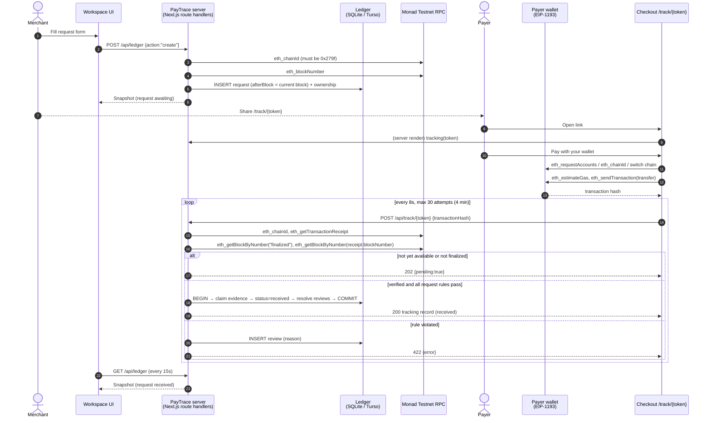

## The 30-second version

<Steps>
  <Step title="Request">The merchant creates an immutable request: amount, receiving wallet, expected payer, and a starting block checkpoint.</Step>
  <Step title="Checkout">The payer opens an unguessable link and sends a direct USDC transfer from their wallet.</Step>
  <Step title="Verification">The server reads the receipt from Monad and checks every rule.</Step>
  <Step title="Claim">If valid, the transfer's unique event ID is claimed and the request becomes `received`, atomically.</Step>
  <Step title="Receipt">Both sides see the same result and can download the evidence.</Step>
</Steps>

## Full sequence

<Accordion title="In plain English" icon="lightbulb">
1. You create a request. PayTrace notes the current blockchain page number.
2. You send your customer the link.
3. Your customer clicks pay; their wallet sends the USDC straight to you and gives back a tracking number (transaction hash).
4. Every 8 seconds the payment page asks PayTrace: "is it done yet?" PayTrace asks the blockchain.
5. Once the payment is permanent and every detail is right, PayTrace marks it **Received** and saves the proof. If something's wrong, it writes a note in your **Needs review** inbox instead.
6. Your dashboard refreshes itself every 15 seconds, so you see it too.
</Accordion>

## Two independent verification paths

| Path | Trigger | Endpoint | Who |
| --- | --- | --- | --- |
| **Checkout verification** | Payer's wallet returns a hash, or payer pastes one | `POST /api/track/{token}` | Public (token holder) |
| **Merchant match** | Merchant pastes a hash in request details | `POST /api/ledger` `{action:"match"}` | Authenticated merchant |

Both call the same `verifyTransfer()` and the same `Ledger.match()`, so they apply identical rules.

## What is stored, and where

| Data | Location | Visible to payer? |
| --- | --- | --- |
| Request (amount, wallets, description, status, proof) | `requests` table (JSON blob) | Yes, minus customer name and notes |
| Customer name / reference | `requests.data.customer` | **No** |
| Internal notes | `requests.data.notes[]` | **No** |
| Evidence claims | `claims` table | No |
| Review items | `reviews` table | No |
| Historical funding | `funding` table | No |
| Payer's submitted tx hash (in progress) | Payer's browser `localStorage` | Their browser only |
| Draft request before sign-in | Merchant's tab `sessionStorage` | Their tab only |

## What never happens

- The server never signs or broadcasts a transaction.
- The browser never supplies "proof"; it only supplies a hash for the server to look up.
- A failed verification never changes the request's financial status.
- A transfer is never split, summed or shared across requests.
