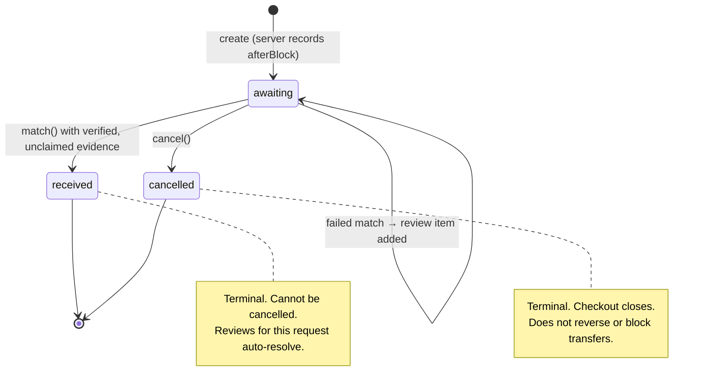

A **payment request** is the core record in PayTrace. It represents a single receivable: *"wallet P owes wallet R exactly N test USDC for D."*

## Fields

| Field | Type | Set by | Mutable | Description |
| --- | --- | --- | --- | --- |
| `id` | `string` | Server | No | `PT-` + random UUID v4 |
| `token` | `string` | Server | No | 24 random bytes as 48 lowercase hex characters. Addresses the public checkout |
| `customer` | `string` (1–80) | Merchant | No | Private customer name or reference |
| `description` | `string` (1–240) | Merchant | No | Shown on checkout |
| `amount` | decimal string | Merchant | No | Normalized to exactly 6 decimals, e.g. `"12.500000"` |
| `recipient` | address | Merchant | No | Lowercased receiving wallet, fixed at creation |
| `payer` | address | Merchant | No | Lowercased expected payer; must differ from recipient |
| `afterBlock` | `number` | Server | No | Monad block number at creation. Evidence must be in a strictly later block |
| `createdAt` | ISO 8601 | Server | No | Creation timestamp |
| `status` | enum | Server | Yes | `awaiting`, `received` or `cancelled` |
| `proof` | `ChainProof \| null` | Server | Once | The verified evidence, set on transition to `received` |
| `notes` | `{text, at}[]` | Merchant | Append-only | Internal notes, max 1000 chars each |

<Accordion title="In plain English" icon="lightbulb">
Once you create a request, the important parts (amount, who pays, who receives) are **locked**. That way neither side can be confused about what was asked. You can only add private notes, or cancel it while it's still unpaid. Changing your receiving wallet in settings later does *not* change existing requests.
</Accordion>

## State machine

### Transition rules

| From | To | Operation | Preconditions | Side effects |
| --- | --- | --- | --- | --- |
| — | `awaiting` | `create` | Valid fields; RPC reports chain `0x279f`; current block readable | Inserts `requests` row + `ownership` row in one transaction |
| `awaiting` | `received` | `match` | All [verification rules](/concepts/verification-rules) pass; evidence unclaimed in this workspace | Inserts `claims` row; writes proof; marks all the request's reviews resolved. Atomic |
| `awaiting` | `cancelled` | `cancel` | Status is `awaiting` | Marks all the request's reviews resolved |
| `awaiting` | `awaiting` | failed `match` (HTTP 422) | — | `INSERT OR IGNORE` review `(request_id, hash)`; capped at 20 per request |
| `received` | any | — | **Rejected** with 409 | — |
| `cancelled` | any | — | **Rejected** with 409 | — |

<Accordion title="In plain English" icon="lightbulb">
A request starts as **Awaiting**. It can only go one of two ways: **Received** (a correct payment arrived) or **Cancelled** (you closed it). Once it's in either of those, it's final. A wrong payment doesn't change the status; it just adds an explanation in your review inbox.
</Accordion>

## Display labels

| Status | Workspace | Checkout headline |
| --- | --- | --- |
| `awaiting` | Awaiting payment | "Payment requested" / "Confirming transfer" while polling |
| `received` | Received | "All accounted for." · "Received. Verified. Recorded." |
| `cancelled` | Cancelled | "This request is closed." |

## Why an expected payer is mandatory

Requiring the payer address up front lets the verifier bind a transfer to *one specific counterparty*. Without it, any third party who happened to send the exact amount to the merchant's address after creation could satisfy the request. The trade-off is that the merchant must know the payer's wallet before issuing the request.

<Accordion title="In plain English" icon="lightbulb">
If PayTrace accepted a payment from *anyone*, a random person sending you the same amount could accidentally "pay" your customer's invoice. Naming the payer's wallet prevents that. The downside: you need to ask your customer for their wallet address first.
</Accordion>

## Why `afterBlock` exists

`afterBlock` prevents **replay of historical transfers**: a transfer included at or before the block in which the request was created is rejected with *"This transfer predates the request. Import it as historical funding instead."* This was validated against live RPC evidence in production acceptance testing.

<Accordion title="In plain English" icon="lightbulb">
Without this, someone could point at an old payment from last month and say "that was for this new invoice." PayTrace records the blockchain page number when you create the request, and only accepts payments written on later pages.
</Accordion>
