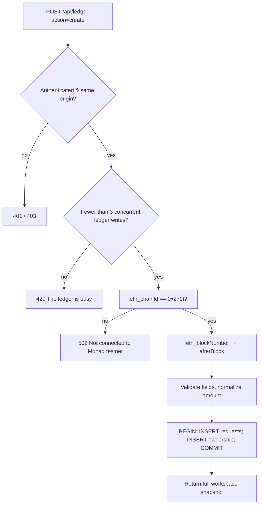

In `/workspace`, click **New payment request**.

## Form fields

| Label | Maps to | Rules |
| --- | --- | --- |
| Customer or reference | `customer` | 1–80 chars. **Private**: never shown on checkout |
| What is this payment for? | `description` | 1–240 chars. Shown to payer |
| Amount in test USDC | `amount` | Up to 12 integer digits and 6 decimals, > 0 |
| Expected payer wallet | `payer` | Valid nonzero address, different from your receiving wallet |

The receiving wallet comes from your settings. If none is saved: *"Save your receiving wallet first."*

## What the server does

<Accordion title="In plain English" icon="lightbulb">
When you click create, PayTrace confirms it's talking to the Monad testnet, notes the current blockchain page number, double-checks your inputs, then saves the request. It hands back your updated dashboard.
</Accordion>

## After creating

Open the request to see its details:
- **Requested amount**, **Receiving wallet**, **Expected payer**
- **Open customer checkout** (the shareable `/track/<token>` link)
- A form to **match a transaction hash** manually
- **Cancel request**, **Internal note**

<Warning>
Tell your payer to send **after** you create the request. Transfers in or before the creation block are rejected as historical.
</Warning>
