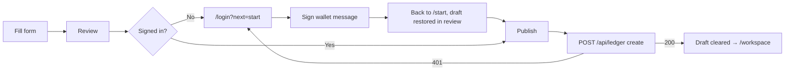

PayTrace is **guest-first**: anyone can prepare a request at [`/start`](https://paytrace-tau.vercel.app/start) without an account. Sign-in is only required to **publish**.

## Fields and validation

| Field | Rule | Error message |
| --- | --- | --- |
| Customer / reference | 1–80 chars after trimming | Enter a customer or reference, up to 80 characters. |
| Description | 1–240 chars | Enter a description, up to 240 characters. |
| Amount | `^\d{1,12}(\.\d{1,6})?$`, > 0 | The amount must be greater than zero. |
| Receiving wallet | 0x + 40 hex, nonzero | Enter valid, nonzero payer and receiving wallets. |
| Expected payer | 0x + 40 hex, nonzero, ≠ receiving | Use different payer and receiving wallets. |

If you're already signed in, the receiving wallet is pre-filled from your workspace settings.

## Draft persistence

On review, the validated draft is saved to `sessionStorage['paytrace-request-draft-v1']`. `sessionStorage` is scoped to **this browser tab** and survives the redirect to `/login` and back, but is cleared when the tab closes. Invalid stored drafts are silently discarded.

<Accordion title="In plain English" icon="lightbulb">
Your draft is remembered only in the current browser tab while you sign in. Close the tab and it's gone, which is intentional: nothing about your customer is saved anywhere until you choose to publish.
</Accordion>

## Publish flow

<Note>
Publishing uses the draft's **explicit receiving wallet** for that request. It does not change your workspace's saved receiving wallet setting.
</Note>

<Tip>
Preparing a request sends no transaction and costs nothing. The customer must pay **after** the request is published, because transfers before the request's starting block are rejected.
</Tip>
